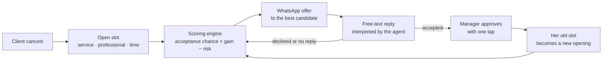

# FlowAgenda-AI

<p align="right">
  <a href="README.md"></a>
  <a href="README.en.md"></a>
</p>

**A cancelled appointment is money gone from the schedule. FlowAgenda-AI brings that money back.**

FlowAgenda-AI is a management platform for a nail salon, with an **AI Agent** at its core. The agent does four things:

- Notices the open slot when someone cancels.
- Picks, with clear criteria and numbers, the client most likely to take that slot.
- Reads the client's WhatsApp reply, written in free text.
- Leaves everything ready for the manager to approve with one tap.

It also takes requests from the manager in plain language: *"who is Lili seeing tomorrow?"*, *"Ester is off on Friday, redistribute her schedule"*, *"what's on the display by the entrance?"*.

This is not a prototype: the system runs today at **Santa Cor Esmalteria**, a real nail salon with about **300 appointments a month**.

> 206 automated tests · auditable decision rules · no schedule change without human approval

The app itself is in Portuguese. Screen and button names below are given in Portuguese, with the English meaning in parentheses.

---

## The problem: the empty chair

Every salon knows the scene. A client cancels in the morning, the 2 p.m. slot goes empty, and nobody has time to call ten people and ask who wants to come in earlier. The professional sits idle, and that revenue never comes back.

Industry numbers show how big this is. They are estimates from companies and trade publications, and they vary from source to source:

| Indicator | Industry estimate |
|---|---|
| Salon appointments lost to no-shows or last-minute cancellations | **15% to 20%**, a figure attributed to the Professional Beauty Association ([Regulr](https://regulr.ai/tools/salon-no-show-calculator)). Salons without automatic confirmation reach **15% to 25%** ([BookrHub, 2026](https://www.bookrhub.com/en/no-show-report-2026)) |
| Monthly revenue nail salons lose to no-shows and late cancellations | **10% to 20%**, according to NAILS Magazine, as cited by [Rosper Tech](https://blog.rospertech.com/nail-salon-no-show-pos-check-in/) |
| Cancellations made within 24 hours of the appointment | **68%** ([BookrHub](https://www.bookrhub.com/en/no-show-report-2026)), exactly when a replacement is hardest to find |

**At Santa Cor.** Over the last 12 months the salon averaged 270 appointments a month (peak of 345), with an average ticket of R$ 77. If 15% of those slots were lost, about **R$ 3,000 a month** would be left on the table. That figure illustrates the industry rate; it is not a measurement of the salon. This is the money the agent goes after.

## The solution: the FlowAgenda AI Agent

Think of the agent as a **receptionist who never forgets anyone**. She knows every client's record by heart: who comes often, who has agreed to come in earlier before, and who tends to miss appointments. She does the math before calling, and only reschedules when the salon owner says "go ahead".

### 1. Coordinates cancellations and fills open slots



1. **Detects the opening** as soon as a confirmed appointment is cancelled, from the panel, the client's personal link or the website.
2. **Works out whom to call.** Only clients who already have a later appointment for the same service, and who agreed to be notified, qualify. Each candidate gets a score that combines three things:
   - the chance she accepts, learned from her history of accepting and declining;
   - her preference for the professional;
   - the risk of a no-show.

   The final figure is **gain from the freed slot − risk on the original slot**. An offer without a positive benefit is never sent.
3. **Recommends and sends** the offer through Meta's official WhatsApp API.
4. **Understands the reply.** "Sure, I can come in earlier" and "can't today, maybe next week" are interpreted by the AI. When a reply is ambiguous, it asks for clarification. A plain "yes" or "no" doesn't even go through the AI.
5. **Cascade.** When a client moves up, her old slot becomes a new opening and the cycle starts again (up to two follow-ups per original opening). A single cancellation can reorganize the whole afternoon.
6. **A human stays in charge.** The client's acceptance waits for the manager's approval. Before saving, the system checks again for conflicts.

The AI does not choose whom to call. The code does, with rules that can be audited and tested. This design came from an evaluation in the original Python project ([agente-remarcacao](agente-remarcacao/README.md)): on hard cases, the language model made worse choices than the calculation. The result is an agent that is predictable, explainable and cheap to run.

### 2. Understands plain language and runs the salon

In the **Assistente** (Assistant) tab, the manager writes the way she would talk to a colleague, and the agent turns the request into action:

| The manager writes | The agent does |
|---|---|
| "how does Lane's schedule look tomorrow?" | Lists that professional's appointments for the day |
| "any slot for a long blow-dry on Saturday?" | Computes the real free slots, using the service's duration and option |
| "how is Maria Souza doing?" | Shows visits, no-shows, total spent and upcoming appointments |
| "today's summary" | Shows appointments, expected revenue, money already received and what is pending |
| "are we out of acetone?" / "what's on the wall panel?" | Searches the stock by meaning, even with nicknames or typos |
| "move Joana from 10 a.m. to Friday at 3 p.m." | Builds a rescheduling plan showing before and after |
| "Ester will be off on Saturday" | Redistributes her schedule among professionals who do the service and are free, starting with each client's favorite |
| "undo that" | Prepares to revert the last change |

Every change becomes a **confirmation card**: before and after, warnings, and a 10-minute expiry. Saving is all or nothing. After confirming, a button appears for each affected client that opens WhatsApp with the notice already written. The AI never makes up a time, a name or an amount: it only calls functions that read the salon's real data.

### 3. Keeps the client relationship going

- **Birthdays.** Shows who has a birthday in the next 7 days, with a greeting and discount coupon ready to send. Clients who already received one this year are marked.
- **Reminders.** A cloud routine prepares reminders before each appointment, even with the panel closed. Silence never cancels a booking.
- **Waiting list.** Clients who wanted a fully booked date are notified when a slot opens for that service.


## See the project

### Just look at the website

The site is published on Cloudflare: **https://santa.cor-esmalteria.workers.dev**. There you can see the home page, the booking flow and the service list as they are today. The admin panel is password-protected, so to try the agent, run the project on your own computer as explained below. You don't need a Cloudflare account or to publish anything.

### Run the agent on your computer

There are four steps: get the AI key, install and start the site, open the panel and load the test cases.

#### 1. Get the AI key (Gemini)

The agent uses Google's Gemini to understand what people write. The key works like a password that gives the project the right to use the AI.

1. Go to **https://aistudio.google.com/apikey** and sign in with a Google account.
2. Click **Create API key**.
3. Copy the key. It starts with `AIza...`.

The free tier is enough for testing. Don't publish the key or push it to GitHub.

#### 2. Install and start the site

You need **Node.js 22.13 or newer** ([nodejs.org](https://nodejs.org)) and a copy of the project (`git clone` or "Download ZIP" on GitHub). Open a terminal in the project folder and run:

```sh
npm run setup
npm run chave:local
```

- `npm run setup` installs the dependencies, builds the site and creates the local database. It takes a few minutes the first time.
- `npm run chave:local` creates the `.dev.vars` file, which holds your computer's secret settings.

Open `.dev.vars` in a text editor and fill in two lines (`APP_SENHA` means "app password"):

```sh
GEMINI_API_KEY="paste-the-key-from-step-1-here"
APP_SENHA="a-password-you-choose"
```

Leave the other lines as they are. `.dev.vars` is never pushed to GitHub. Then start the site:

```sh
npm run dev
```

The terminal shows an address, usually **http://localhost:5173**. Keep the terminal open while you use the site. To stop it, press `Ctrl + C`.

> **On Windows (PowerShell):** if you get a "running scripts is disabled" error, use `npm.cmd` instead of `npm` (for example, `npm.cmd run dev`). If you change `.dev.vars` while the site is running, stop it with `Ctrl + C` and run `npm run dev` again.

#### 3. Open the panel and the agent

1. Open **http://localhost:5173**.
2. Scroll to the **bottom of the page** and click **Acesso da equipe** (Staff access).
3. Enter the password you set in `APP_SENHA`.
4. In the left menu, click **Assistente** (Assistant).
5. Type a request. The agent answers in Portuguese, for example *"resumo de hoje"* (today's summary) or *"quem tem horário amanhã?"* (who has an appointment tomorrow?).

If the Assistant says it "ainda não está configurado" (is not configured yet), the `GEMINI_API_KEY` wasn't loaded. Check `.dev.vars` and restart `npm run dev`.

#### 4. Load the test cases

The database starts empty, and the agent needs clients and appointments to work with. With the site running, open **another terminal** in the same folder and run one of these commands:

```sh
npm run exemplos:local    # 50 clients, 3 professionals, plus rescheduling, finance and stock cases
npm run exemplos:semana   # a full week of busy schedule, with cancellations and offers
```

The names are made up and there are no real phone numbers. Each command creates a **separate area** and ends by printing a link like this:

```
http://localhost:5173/painel#room=exemplos-1a2b3c
```

To open that area:

1. If you are already in the panel, click **Sair do painel** (Log out).
2. Open the link the command printed and sign in with the same password.
3. Try things out:
   - In **Assistente**, ask *"como está a agenda de amanhã?"* (how does tomorrow look?), *"tem horário pra manicure sexta?"* (any manicure slot on Friday?) or *"a [professional's name] vai faltar amanhã"* ([name] will be off tomorrow).
   - In **Remarcações** (Rescheduling), see the openings created by cancellations, the offers the agent built and the clients' replies.

Running a command again creates another area without deleting the earlier ones. A guide to what to test in each tab is in [examples/README.md](examples/README.md) (in Portuguese).

## Where each part lives

| Part | Location |
|---|---|
| Rescheduling engine (decides whom to call) | `lib/flowagenda.mjs` (`candidates`, `score` and `seek` functions) |
| Interpretation of client replies | `lib/response-agent.ts` |
| Plain-language assistant | `lib/assistente/`, `app/assistente-panel.tsx`, `app/api/assistente/` |
| Official WhatsApp (webhook, queue, reminders) | `lib/whatsapp*.{ts,mjs}`, `worker/index.ts` |
| Website booking | `lib/agendamento.mjs`, `app/agendar/` |
| Finance and revenue forecast | `lib/finance-core.mjs`, `lib/previsao.mjs` |
| Tests (`npm test`) | `tests/` |
| Original Python project | `agente-remarcacao/` |
