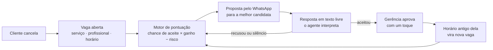

# FlowAgenda-AI

**Um horário cancelado é dinheiro que some da agenda. O FlowAgenda-AI devolve esse dinheiro.**

FlowAgenda-AI é a plataforma de gestão de uma esmalteria com um **AI Agent** no centro. O agente faz quatro coisas:

- Percebe a vaga quando alguém cancela.
- Escolhe, com critério e números, quem tem mais chance de aceitar o horário.
- Lê o que a cliente responde no WhatsApp, em texto livre.
- Deixa tudo pronto para a gerência aprovar com um toque.

Também atende a gerência em português comum: *"quem a Lili atende amanhã?"*, *"a Ester vai faltar sexta, redistribui a agenda dela"*, *"o que tem no expositor da entrada?"*.

Não é protótipo: o sistema roda hoje na **Santa Cor Esmalteria**, com cerca de **300 atendimentos por mês**.

> 224 testes automatizados · regras de decisão auditáveis · nenhuma mudança na agenda sem aprovação humana

---

## O problema: a cadeira vazia

Todo salão conhece a cena. A cliente desmarca de manhã, o horário das 14h fica vago, e ninguém tem tempo de ligar para dez pessoas e perguntar quem quer vir mais cedo. A profissional fica parada, e aquele faturamento não volta.

Os números do setor mostram o tamanho disso. São estimativas de empresas e publicações do ramo; os valores mudam de fonte para fonte:

| Indicador | Estimativa do setor |
|---|---|
| Agendamentos perdidos para falta ou cancelamento de última hora em salões | **15% a 20%**, número atribuído à Professional Beauty Association ([Regulr](https://regulr.ai/tools/salon-no-show-calculator)). Em salões sem confirmação automática chega a **15% a 25%** ([BookrHub, 2026](https://www.bookrhub.com/en/no-show-report-2026)) |
| Receita mensal que esmalterias perdem com faltas e cancelamentos tardios | **10% a 20%**, segundo a NAILS Magazine, citada pela [Rosper Tech](https://blog.rospertech.com/nail-salon-no-show-pos-check-in/) |
| Cancelamentos que acontecem nas 24 horas antes do horário | **68%** ([BookrHub](https://www.bookrhub.com/en/no-show-report-2026)), justamente quando é mais difícil achar substituta |

**Na Santa Cor.** Nos últimos 12 meses foram em média 270 atendimentos por mês (pico de 345), com ticket médio de R$ 77. Se 15% desses horários se perdessem, seriam cerca de **R$ 3.000 por mês** que ficariam na mesa. Esse valor é uma ilustração com a taxa do setor, não uma medição do salão. É esse dinheiro que o agente vai buscar.

## A solução: o AI Agent do FlowAgenda

Pense no agente como uma **recepcionista que nunca esquece ninguém**. Ela sabe de cabeça a ficha de cada cliente: quem costuma vir, quem já aceitou adiantar e quem costuma faltar. Faz as contas antes de ligar, e só remarca quando a dona do salão diz "pode".

### 1. Coordena cancelamentos e preenche horários vagos



1. **Detecta a vaga** assim que um horário confirmado é cancelado, pelo painel, pelo link da cliente ou pelo site.
2. **Analisa quem chamar.** Vale só quem já tem horário mais tarde para o mesmo serviço e autorizou ser avisada. Cada candidata recebe uma nota que combina três coisas:
   - a chance de aceitar, aprendida com o histórico dela de aceites e recusas;
   - a preferência pela profissional;
   - o risco de falta.

   A conta final é **ganho do horário liberado − risco do horário de origem**. Proposta sem benefício positivo nem sai.
3. **Recomenda e envia** a proposta pelo WhatsApp oficial da Meta.
4. **Entende a resposta.** "Pode ser sim, consigo ir mais cedo" e "hoje não dá, quem sabe semana que vem" são interpretadas pela IA. Se a resposta for ambígua, ela pede esclarecimento. Um "sim" ou "não" direto nem passa pela IA.
5. **Cascata.** Quando a cliente adianta, o horário antigo dela vira uma nova vaga, e o ciclo recomeça (até dois desdobramentos por vaga original). Um único cancelamento pode reorganizar a tarde inteira.
6. **Humano no comando.** O aceite da cliente espera a aprovação da gerência. Antes de gravar, o sistema confere de novo se houve conflito.

A IA não escolhe quem chamar. Quem escolhe é o código, com regras que dá para auditar e testar. Esse desenho veio de uma avaliação no projeto original em Python ([agente-remarcacao](agente-remarcacao/README.md)): nos casos difíceis, o modelo de linguagem decidia pior que o cálculo. O resultado é um agente previsível, explicável e barato.

### 2. Entende linguagem natural e opera o salão

Na aba **Assistente**, a gerência escreve como falaria com uma colega, e o agente transforma o pedido em ação:

| A gerência escreve | O agente faz |
|---|---|
| "como está a agenda da Lane amanhã?" | Lista os atendimentos do dia daquela profissional |
| "tem horário pra escova longa sábado?" | Calcula os horários livres de verdade, com duração e opção do serviço |
| "como anda a Maria Souza?" | Mostra visitas, faltas, quanto gastou e os próximos horários |
| "resumo de hoje" | Mostra atendimentos, receita prevista, quanto já entrou e o que está pendente |
| "acabou a acetona?" / "o que tem no painel da parede?" | Consulta o estoque pelo sentido, mesmo com apelido ou erro de digitação |
| "passa a Joana das 10h pra sexta às 15h" | Monta o plano de remarcação com o antes e o depois |
| "a Ester vai faltar sábado" | Redistribui a agenda dela entre quem faz o serviço e está livre, começando pela preferida de cada cliente |
| "desfaz isso" | Prepara a volta da última mudança |

Toda mudança vira um **cartão de confirmação**: antes e depois, avisos e validade de 10 minutos. A gravação é tudo ou nada. Depois de confirmar, aparece um botão por cliente afetada que abre o WhatsApp com o aviso já escrito. A IA nunca inventa horário, nome ou valor: ela só chama funções que leem os dados reais do salão.

### 3. Mantém o relacionamento com a clientela

- **Aniversários.** Mostra quem faz aniversário nos próximos 7 dias, com parabéns e cupom de desconto prontos para enviar. Quem já recebeu no ano fica marcada.
- **Lembretes.** A rotina na nuvem prepara lembretes antes do horário, mesmo com o painel fechado. Silêncio nunca cancela uma reserva.
- **Lista de espera.** Quem quis uma data cheia é avisada quando abre vaga para aquele serviço.


## Ver o projeto

### Só olhar o site

O site está publicado no Cloudflare: **https://santa.cor-esmalteria.workers.dev**. Ali dá para ver a página inicial, o agendamento e a lista de serviços como estão hoje. O painel da administração é protegido por senha, então para mexer no agente rode o projeto no seu computador, como explicado abaixo. Não precisa criar conta no Cloudflare nem publicar nada.

### Rodar o agente no seu computador

São quatro passos: pegar a chave da IA, instalar e ligar o site, entrar no painel e carregar os casos de teste.

#### 1. Pegue a chave da IA (Gemini)

O agente usa o Gemini, do Google, para entender o que se escreve. A chave é como uma senha que dá ao projeto o direito de usar a IA.

1. Entre em **https://aistudio.google.com/apikey** com uma conta Google.
2. Clique em **Create API key** (Criar chave de API).
3. Copie a chave. Ela começa com `AIza...`.

O plano gratuito basta para testar. Não publique a chave nem a mande para o GitHub.

#### 2. Instale e ligue o site

Você precisa do **Node.js 22.13 ou mais novo** ([nodejs.org](https://nodejs.org)) e do projeto baixado (`git clone` ou "Download ZIP" no GitHub). Abra um terminal na pasta do projeto e rode:

```sh
npm run setup
npm run chave:local
```

- `npm run setup` instala as dependências, monta o site e cria o banco de dados local. Demora alguns minutos na primeira vez.
- `npm run chave:local` cria o arquivo `.dev.vars`, onde ficam as configurações secretas do seu computador.

Abra o `.dev.vars` num editor de texto e preencha duas linhas:

```sh
GEMINI_API_KEY="cole-aqui-a-chave-do-passo-1"
APP_SENHA="uma-senha-que-voce-escolher"
```

Deixe as outras linhas como estão. O `.dev.vars` não vai para o GitHub. Depois, ligue o site:

```sh
npm run dev
```

O terminal mostra um endereço, normalmente **http://localhost:5173**. Deixe o terminal aberto enquanto usa o site. Para desligar, aperte `Ctrl + C`.

> **No Windows (PowerShell):** se aparecer um erro de "execução de scripts desabilitada", troque `npm` por `npm.cmd` (por exemplo, `npm.cmd run dev`). Se mudar o `.dev.vars` com o site ligado, desligue com `Ctrl + C` e rode `npm run dev` de novo.

#### 3. Entre no painel e abra o agente

1. Abra **http://localhost:5173**.
2. Desça até o **final da página** e clique em **Acesso da equipe**.
3. Digite a senha que você colocou em `APP_SENHA`.
4. No menu da esquerda, clique em **Assistente**.
5. Escreva um pedido, por exemplo *"resumo de hoje"* ou *"quem tem horário amanhã?"*.

Se o Assistente responder que "ainda não está configurado", a `GEMINI_API_KEY` não foi lida. Confira o `.dev.vars` e reinicie o `npm run dev`.

#### 4. Carregue os casos de teste

O banco começa vazio, e o agente precisa de clientes e horários para trabalhar. Com o site ligado, abra **outro terminal** na mesma pasta e rode um destes comandos:

```sh
npm run exemplos:local    # 50 clientes, 3 profissionais e casos de remarcação, finanças e estoque
npm run exemplos:semana   # uma semana inteira de agenda cheia, com cancelamentos e propostas
```

Os nomes são inventados e não há telefones reais. Cada comando cria uma **área separada** e mostra no fim um link parecido com:

```
http://localhost:5173/painel#room=exemplos-1a2b3c
```

Para entrar nessa área:

1. Se já estiver no painel, clique em **Sair do painel**.
2. Abra o link que o comando mostrou e entre com a mesma senha.
3. Teste à vontade:
   - Em **Assistente**, peça *"como está a agenda de amanhã?"*, *"tem horário pra manicure sexta?"* ou *"a [nome de uma profissional] vai faltar amanhã"*.
   - Em **Remarcações**, veja as vagas abertas pelos cancelamentos, as propostas que o agente montou e as respostas das clientes.

Rodar de novo cria outra área, sem apagar as anteriores. O roteiro do que testar em cada aba está em [examples/README.md](examples/README.md).

## Onde fica cada parte

| Peça | Onde fica |
|---|---|
| Motor de remarcação (decide quem chamar) | `lib/flowagenda.mjs` (funções `candidates`, `score` e `seek`) |
| Interpretação das respostas da cliente | `lib/response-agent.ts` |
| Assistente em linguagem natural | `lib/assistente/`, `app/assistente-panel.tsx`, `app/api/assistente/` |
| WhatsApp oficial (webhook, fila, lembretes) | `lib/whatsapp*.{ts,mjs}`, `worker/index.ts` |
| Agendamento pelo site | `lib/agendamento.mjs`, `app/agendar/` |
| Finanças e previsão de faturamento | `lib/finance-core.mjs`, `lib/previsao.mjs` |
| Testes (`npm test`) | `tests/` |
| Projeto original em Python | `agente-remarcacao/` |
