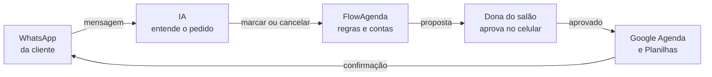
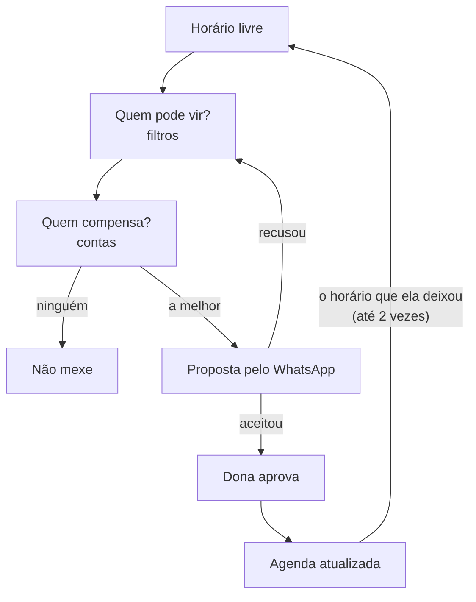

# FlowAgenda

**Cancelamento vira hora vazia. O FlowAgenda transforma hora vazia em hora recuperada.**

Agenda para salões pequenos que se reorganiza sozinha quando alguém cancela: encontra quem pode vir
antes, escreve a mensagem, entende a resposta e só mexe na agenda depois que a dona aprova.

<!-- GIF da demonstração: gravar e salvar em docs/demo.gif, depois trocar esta linha por  -->
> GIF da demonstração: em breve.

Hoje roda com dados fictícios e um WhatsApp simulado: nenhuma mensagem real é enviada.

---

## O problema

Num salão com duas ou três profissionais, a agenda costuma morar num caderno e no WhatsApp. Quando uma
cliente cancela em cima da hora, o prejuízo é concreto:

- **o horário pago some**: a profissional fica parada e o salão perde a receita daquele atendimento;
- **remarcar dá trabalho**: a dona para o que está fazendo, procura no caderno, manda mensagem para uma,
  espera, tenta outra;
- **puxar a pessoa errada piora**: antecipar alguém abre um buraco novo no horário dela, que pode ser
  mais difícil de preencher do que o primeiro;
- **incomodar quem não quer**: quem escolheu um horário tarde de propósito não gosta de ser chamada
  para antes.

A pergunta certa não é "quem pode vir?", e sim:

> Puxar quem, de qual dia, deixa a agenda **menos vazia** no fim, sem incomodar quem não quer?

## A proposta

Automatizar o agendamento e a remarcação, deixando cada parte com quem faz melhor:

- **as contas e as regras ficam com o código**: quem pode, quem compensa, quem chamar primeiro. É sempre
  o mesmo resultado, dá para testar e dá para explicar;
- **a IA entra só onde há texto livre**: entender o que a cliente escreveu ("hj n", "só depois das 17h",
  "quanto custa?");
- **a dona do salão decide**: nada muda na agenda sem ela tocar em Aprovar, de preferência pelo celular.

## Como vai funcionar



1. A cliente escreve no WhatsApp: quer marcar, cancelar ou está respondendo a uma proposta.
2. A IA lê a mensagem e diz o que ela quer. É o único passo que usa IA.
3. O FlowAgenda aplica as regras: acha o horário livre ou, num cancelamento, decide quem chamar para antes.
4. A dona do salão vê a proposta no celular e aprova (ou não).
5. A agenda é atualizada e a cliente recebe a confirmação.

Hoje os passos 2 a 4 já funcionam, com o WhatsApp simulado no painel e a agenda em arquivos. O WhatsApp
de verdade, o Google Agenda e as Planilhas estão em construção (lista mais abaixo).

## Por dentro de uma remarcação

Quando um horário fica livre, o código passa por estas etapas. Se alguém for antecipada, o horário que
ela deixou entra de novo no começo (a cascata), até dois níveis.



### Como o código pesa cada candidata

Tudo em [`src/score.py`](src/score.py), com testes:

| Fator | Conta | Por quê |
|---|---|---|
| Chance de faltar | `(faltas + 1) / (visitas + 4)` | Suavizada: 1 falta em 1 visita vira 40%, não 100%. |
| Chance de aceitar | `(aceitas + 2 × nota/10) / (propostas + 2)` | Sem histórico, vale a nota de 0 a 10 que a própria cliente deu; com o tempo, o histórico manda. Nota 0: nunca é chamada. |
| Dificuldade de preencher | `1 − [0,6 × aviso × procura + 0,4 × fila]` | Mais aviso e mais fila, mais fácil achar outra pessoa. Com a agenda vazia (pouca procura), aviso não ajuda. |
| Escolheu tarde de propósito | nota cai para 2 | Quem marcou tarde havendo horário antes provavelmente não quer antecipar. |

A regra central, em reais:

```
valor esperado = chance de aceitar × [ valor do horário livre × (dificuldade dele − chance de faltar)
                                       − valor do horário dela × dificuldade do horário dela ]
```

Só compensa puxar alguém se o buraco novo for mais fácil de preencher do que o atual, descontado o
risco de ela faltar. Se ninguém compensa, o FlowAgenda **decide não mexer**, e isso também é uma decisão.

## Quem faz o quê

| Parte | Quem faz | Onde |
|---|---|---|
| Filtros, contas e poda | Código | `src/filtros.py`, `src/score.py`, `src/ferramentas.py` |
| Escolher a cliente, justificar e montar a mensagem | Código | `src/escolha.py` |
| Entender a resposta da cliente | IA | `src/interpretacao.py` |
| Cascata e plano B na recusa | Código | `src/cascata.py` (terminal), `src/estado.py` (tela) |
| Mudar a agenda | Código, **só depois da aprovação** | `aplicar_movimento_aprovado` em `src/ferramentas.py` |
| Página pública e painel | Streamlit | `app.py`, `paginas/` |
| Visitas, faltas e propostas | Código | `src/historico.py` |

## O que já funciona e o que vem

- [x] Remarcação em cascata com filtros, conta, poda e plano B na recusa
- [x] Várias profissionais, com a preferida da cliente primeiro
- [x] Aprovação da dona antes de qualquer mudança
- [x] IA interpretando respostas (120 de 120 certas nos testes difíceis)
- [x] Página pública do salão com botão para o WhatsApp
- [x] Painel e cadastro escondidos, com senha
- [x] Registro de visitas, faltas e propostas ("Fechar o dia")
- [ ] IA entendendo a intenção de qualquer mensagem (marcar, cancelar, responder)
- [ ] Marcar horário novo a partir da mensagem, com aprovação
- [ ] Google Agenda e Google Planilhas no lugar dos arquivos (encaixe pronto em `src/agenda_externa.py`)
- [ ] WhatsApp de verdade: primeiro um botão "abrir no WhatsApp" com a mensagem pronta, depois a API oficial
- [ ] Modo real: relógio de verdade no lugar dos cenários
- [ ] Publicar o site (guia em [docs/hospedagem.md](docs/hospedagem.md))

## Resultados

Oito cenários montados para provar cada regra, três estratégias. A métrica é **horas vagas esperadas
no fim** (menor é melhor): a chance de cada horário mexido acabar vazio, vezes a duração dele.
Detalhes em [docs/metrica.md](docs/metrica.md).

| Cenário | O que prova | Ninguém faz nada | Regra ingênua | FlowAgenda |
|---|---|---|---|---|
| 1 Aviso tardio | filtros duros e poda | 0,73 | 0,16 | 0,16 (empate) |
| 2 Cascata que compensa | troca buraco difícil por fácil | 0,69 | 0,33 | **0,20** |
| 3 Cascata que não compensa | decidir não agir | 0,71 | 0,80 (pior que nada) | **0,71** |
| 4 Recusa | plano B | 0,59 | 0,44 | 0,44 (empate) |
| 5 Cliente nova | suavização da chance de faltar | 0,61 | 0,32 | **0,30** |
| 6 Dia lotado | uso da ocupação do dia | 0,62 | 0,36 | **0,06** |
| 7 Profissional preferida | primeiro quem prefere a profissional do horário | 0,58 | 0,06 | 0,06 (empate) |
| **Total** | | **4,55** | **2,48 (−46%)** | **1,94 (−57%)** |

A "regra ingênua" é o que se faria à mão: oferecer em ordem cronológica para quem pode, sem conta e
sem cascata. Ela empata em três cenários; a explicação está em [resultados.md](resultados.md).

> **Pendente:** esta tabela é de antes da ocupação do dia entrar na conta e não tem o cenário 8
> (agenda com folga). A simulação sem IA mostra os cenários 1 a 7 terminando igual; falta rodar
> `python avaliar.py` de novo quando a cota diária do Gemini voltar.

> **Atenção:** são estimativas feitas com o próprio modelo de conta, sobre **dados fictícios** e com
> respostas roteirizadas. Mostram que as decisões são coerentes, não medem ganho no mundo real.

A parte de IA também tem um teste próprio, com 40 respostas estranhas e 12 situações armadilha, rodados
três vezes: [docs/avaliacao-ia.md](docs/avaliacao-ia.md).

## Como rodar

Precisa de Python 3.11 ou mais novo (testado no 3.14) e de uma chave gratuita do Gemini
([aistudio.google.com/apikey](https://aistudio.google.com/apikey)).

```bash
git clone https://github.com/samuel000px/FlowAgenda-AI.git
cd FlowAgenda-AI/agente-remarcacao
python -m venv venv
```

Ative o ambiente (`venv\Scripts\activate` no Windows, `source venv/bin/activate` no Linux/macOS) e instale:

```bash
pip install -r requirements.txt
```

Copie `.env.example` para `.env` (`copy` no Windows, `cp` no Linux/macOS) e coloque a sua chave em
`GEMINI_API_KEY=`. O `.env` não vai para o git.

| Comando | O que faz | Usa o Gemini? |
|---|---|---|
| `streamlit run app.py` | O site: página pública em `/`, painel em `/painel`, clientes e equipe em `/equipe` | Sim, para ler as respostas |
| `python terminal.py S1` | Um cenário no terminal; você responde como a cliente e aprova | Sim |
| `python terminal.py S1 --auto` | O mesmo, com respostas prontas e aprovação automática | Sim |
| `pytest` | 121 testes | Não |
| `python avaliar.py` | Os cenários nas 3 estratégias; reescreve `resultados.md` | Sim |
| `python avaliar_ia.py` | Só a parte de IA, com casos difíceis; escreve `docs/avaliacao-ia.md` | Sim |
| `python prova_de_vida.py` | Confere se a chave funciona | Sim |

Os cenários vão de `S1` a `S8`. A camada gratuita do Gemini limita chamadas por minuto e por dia;
quando bate o limite por minuto, o código espera e tenta de novo.

### No painel

- **Remarcação**: escolha um cenário, toque em **Escolher e enviar proposta**, responda como a cliente
  (Aceita, Recusa, Outro horário, texto livre ou **Não respondeu**) e aprove ou rejeite.
- **Fechar o dia** (painel lateral, com "Usar e registrar histórico" ligado): marque **Veio** ou
  **Faltou** em cada horário. Tudo vai para `registro/historico.csv`, uma linha por acontecimento, fora do git.
- **Clientes e equipe**: os números de cada cliente e quem prefere qual profissional.

### Página pública e celular

Os dados públicos do salão (nome, WhatsApp, endereço, serviços) ficam em `data/salao.local.json`, fora
do git; o `data/salao.json` do repositório tem dados de exemplo. Numa hospedagem, use o segredo
`SALAO_JSON`. Para o painel pedir senha, configure `APP_SENHA`. O passo a passo para publicar está em
[docs/hospedagem.md](docs/hospedagem.md).

## Estrutura do projeto

```
agente-remarcacao/
├── app.py                 entrada do site: página pública, /painel e /equipe
├── terminal.py            roda um cenário no terminal
├── avaliar.py             compara as 3 estratégias nos cenários (resultados.md)
├── avaliar_ia.py          mede só a parte de IA (docs/avaliacao-ia.md)
├── prova_de_vida.py       confere se a chave do Gemini funciona
│
├── src/                   o FlowAgenda em si, sem tela
│   ├── modelos.py         Cliente, Slot (horário), Dia, Cenario, Candidato, Decisao
│   ├── dados.py           lê e confere os arquivos de data/
│   ├── filtros.py         quem pode ser chamada
│   ├── score.py           as contas (falta, aceitar, dificuldade, valor esperado)
│   ├── ferramentas.py     busca e ordena candidatas; troca horários depois da aprovação
│   ├── escolha.py         escolhe a cliente e monta justificativa e mensagem
│   ├── cascata.py         remarcação completa de uma vez (terminal e avaliação)
│   ├── estado.py          a mesma remarcação, um clique por vez (tela)
│   ├── interpretacao.py   a IA lê a resposta da cliente
│   ├── llm.py             único arquivo que fala com o Gemini
│   ├── canal.py           WhatsApp (hoje simulado)
│   ├── agenda_externa.py  encaixe para o Google Agenda
│   ├── historico.py       visitas, faltas e propostas em CSV
│   ├── metrica.py         horas vagas esperadas
│   ├── salao.py           dados públicos do salão
│   └── acesso.py          senha do painel
│
├── paginas/               as telas (Streamlit)
│   ├── inicio.py          página pública
│   ├── painel.py          remarcação e "Fechar o dia"
│   ├── cadastro.py        clientes e equipe
│   ├── comum.py           senha, menu e estilo compartilhados
│   ├── formatos.py        textos curtos das telas (datas, situação do horário)
│   └── estilos/           CSS de cada página
│
├── data/                  dados fictícios (clientes, agendas, cenários, salão)
├── avaliacao_ia/          casos difíceis e o experimento da IA escolhendo
├── tests/                 testes (não chamam a IA)
└── docs/                  métrica, hospedagem, Google Agenda, avaliação da IA
```

## Decisões de projeto

- **Contas e escolha no código, interpretação na IA.** A escolha da cliente já foi da IA. Nos testes
  difíceis ela às vezes se afastou do valor esperado para pior, e os critérios que ensinaríamos a ela
  são os mesmos da conta. Agora o código escolhe, e a IA só lê as respostas: uma chamada por proposta.
- **Aprovação humana.** Mudar o horário de alguém é decisão da dona do salão. Um erro de leitura da IA
  não pode virar uma cliente desmarcada.
- **Uma proposta de cada vez.** O horário fica reservado para quem recebeu a proposta. Não existe
  "quem responder primeiro leva".
- **Poucos dados pessoais.** Para a IA vai só o primeiro nome, sem telefone nem anotações. Não
  guardamos distância: a própria cliente diz se consegue chegar.
- **Peças trocáveis.** O WhatsApp entra por uma interface `Canal` e o Google Agenda por uma interface
  `AgendaExterna`. Trocar a peça não mexe no resto.
- **Gemini em vez de Claude**, por custo (camada gratuita). Só `src/llm.py` fala com o modelo.

Todas as decisões, com o motivo e a alternativa descartada, estão em [DECISIONS.md](DECISIONS.md).

## Limitações

- Dados fictícios: 23 clientes, 3 profissionais e 8 cenários montados à mão.
- Os pesos da conta (0,6 e 0,4, 48h, 3 pessoas na fila, 80% de ocupação) foram chutados, sem calibração com dados reais.
- A fila de espera é só um número; ninguém da fila é chamado de fato.
- "Outro horário" é entendido, mas ainda não renegociado: conta como recusa.
- WhatsApp simulado e respostas roteirizadas na avaliação.

## Créditos

O FlowAgenda nasceu ao lado do **Encaixa · Esmalteria**, de **Samuel Almeida**, que está na raiz deste
repositório. Nenhuma linha de código foi copiada (o Encaixa é TypeScript), mas várias ideias vieram dele:

- os filtros de elegibilidade (serviço, duração, horário posterior);
- conferir tudo de novo antes de confirmar uma mudança;
- recusou, passa para a próxima, sem repetir quem já recusou;
- os cuidados com a IA: timeout, limite de tokens, conferir o formato da resposta e tratar o texto da
  cliente como dado, não como instrução;
- os nomes das clientes e das profissionais fictícias.

A análise completa do que foi aproveitado está em [AUDITORIA.md](AUDITORIA.md).
