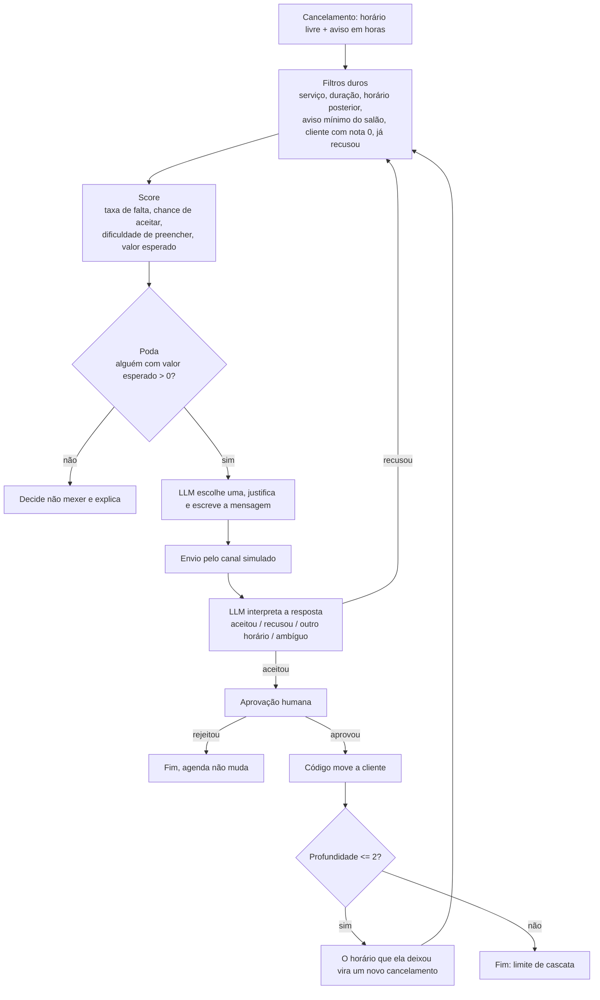

# Agente de remarcação

**Cancelamento vira hora vazia. O agente transforma hora vazia em hora recuperada.**

<!-- GIF da demonstração: gravar e salvar em docs/demo.gif, depois trocar esta linha por  -->
> GIF da demonstração: em breve.

Dados fictícios · canal de mensagens simulado · nenhuma mensagem real é enviada.

---

## O problema

Numa esmalteria com uma manicure só, cada cancelamento em cima da hora é um horário pago que some.
A cliente que cancelou não perde nada, mas a manicure perde o atendimento e a esmalteria perde a receita.
Muitas vezes há outra cliente marcada para daqui a alguns dias que toparia vir antes. Só que puxar essa
cliente abre um **buraco novo** no horário dela. Então a pergunta certa não é "quem pode vir?", e sim:

> Puxar quem, de qual dia, deixa a agenda **menos vazia** no fim?

## Como o agente decide



**Os quatro fatores**, todos calculados pelo código em [`src/score.py`](src/score.py):

| Fator | Conta | Por quê |
|---|---|---|
| Taxa de falta | `(faltas + 1) / (consultas + 4)` | Suavizada: 1 falta em 1 consulta vira 40%, não 100%. |
| Chance de aceitar | `(aceitas + 2 × nota/10) / (propostas + 2)` | Sem histórico, vale a nota de 0 a 10 que a própria cliente deu; com o tempo, o histórico manda. Nota 0 = nunca é chamada. |
| Aviso que sobra | entra na dificuldade de preencher | Mais horas de aviso, mais fácil achar outra pessoa. |
| Ocupação do dia | fila de espera do dia | Dia lotado, com fila, preenche o buraco novo rápido. |

`dificuldade_de_preencher = 1 − [0,6 × min(aviso/48h, 1) + 0,4 × min(fila/3, 1)]`, de 0 (fácil) a 1 (difícil).

**A regra central:** só compensa puxar alguém se o buraco novo for mais fácil de preencher do que o
atual, descontado o risco de ela faltar. Em reais:

```
valor_esperado = chance_de_aceitar × [ valor_vago × (dificuldade_vago − taxa_falta) − valor_dela × dificuldade_dela ]
```

Se ninguém tem valor esperado positivo, o agente **decide não mexer**, e isso também é uma decisão.

### Quem faz o quê

| Parte | Quem faz | Onde |
|---|---|---|
| Filtros duros, contas, poda | Código | `src/filtros.py`, `src/score.py`, `src/ferramentas.py` |
| Escolher entre as que sobraram, justificar e escrever a mensagem | LLM | `src/agente.py` |
| Entender a resposta da cliente | LLM | `src/interpretacao.py` |
| Profundidade da cascata e plano B na recusa | Código | `src/cascata.py` (terminal), `src/estado.py` (tela) |
| Mudar a agenda | Código, **só depois da aprovação humana** | `confirmar_movimento` em `src/ferramentas.py` |

O modelo só tem acesso a duas ferramentas: `buscar_candidatos` (devolve as candidatas já filtradas e com
os números) e `propor_remarcacao` (guarda um rascunho, não envia nada). `confirmar_movimento` não está
na lista que o modelo recebe, e um teste garante isso.

## Resultados

Seis cenários, três estratégias. A métrica é **horas vagas esperadas no fim** (menor é melhor):
a chance de cada horário mexido acabar vazio, vezes a duração dele. Detalhes em [docs/metrica.md](docs/metrica.md).

| Cenário | O que prova | Ninguém faz nada | Regra ingênua | Agente |
|---|---|---|---|---|
| 1 Aviso tardio | filtros duros e poda | 0,73 | 0,16 | 0,16 (empate) |
| 2 Cascata que compensa | troca buraco difícil por fácil | 0,69 | 0,33 | **0,20** |
| 3 Cascata que não compensa | decidir não agir | 0,71 | 0,80 (pior que nada) | **0,71** |
| 4 Recusa | plano B | 0,59 | 0,44 | 0,44 (empate) |
| 5 Cliente nova | suavização da taxa de falta | 0,61 | 0,32 | **0,30** |
| 6 Dia lotado | uso da ocupação do dia | 0,62 | 0,36 | **0,06** |
| **Total** | | **3,97** | **2,42 (−39%)** | **1,87 (−53%)** |

A "regra ingênua" oferece o horário em ordem cronológica para quem passa nos filtros duros, sem score,
sem poda e sem cascata. Ela empata com o agente em dois cenários, e a explicação está em
[resultados.md](resultados.md), gerado por `python avaliar.py` com o Gemini.

> **Atenção:** são estimativas feitas com o próprio modelo de score, sobre **dados fictícios** e com
> respostas das clientes roteirizadas. Servem para mostrar que as decisões são coerentes, não para
> medir ganho no mundo real.

## Como rodar

Precisa de Python 3.11 ou mais novo (testado no 3.14) e de uma chave gratuita do Gemini
([aistudio.google.com/apikey](https://aistudio.google.com/apikey)).

```bash
git clone https://github.com/samuel000px/FlowAgenda-AI.git
cd FlowAgenda-AI/agente-remarcacao
python -m venv venv
```

Ative o ambiente (`venv\Scripts\activate` no Windows, `source venv/bin/activate` no Linux/macOS) e instale:

```bash
pip install -r requirements.txt
```

Copie `.env.example` para `.env` (`copy` no Windows, `cp` no Linux/macOS) e coloque a sua chave em
`GEMINI_API_KEY=`. O `.env` não vai para o git.

| Comando | O que faz | Usa o Gemini? |
|---|---|---|
| `pytest` | 70 testes da lógica, da cascata, da tela e da ponte com agenda externa | Não |
| `streamlit run app.py` | A interface: agenda, chat simulado e raciocínio do agente | Sim |
| `python terminal.py S1` | Um cenário no terminal; você responde como a cliente e aprova | Sim |
| `python terminal.py S1 --auto` | O mesmo, com as respostas prontas do cenário e aprovação automática | Sim |
| `python avaliar.py` | Roda os 6 cenários com as 3 estratégias e reescreve `resultados.md` | Sim |
| `python prova_de_vida.py` | Confere se a chave funciona | Sim |

Os cenários vão de `S1` a `S6`. Cada execução no terminal grava um log em `logs/`. A camada gratuita
do Gemini limita chamadas por minuto; quando isso acontece, o código espera e tenta de novo.

## Decisões de projeto

- **Contas no código, escolha no LLM.** Taxa de falta, valor esperado e filtros são contas que precisam
  dar sempre o mesmo resultado e ser testadas. O modelo entra onde há texto: escolher entre as candidatas que
  sobraram, escrever a mensagem e entender a resposta da cliente.
- **Poucos dados pessoais.** O cadastro tem só nome, visitas, faltas e a nota de 0 a 10. Para o modelo vai
  só o primeiro nome, sem telefone nem anotações. Não guardamos distância: a própria cliente diz se
  consegue chegar, e o salão define um aviso mínimo (`AVISO_MINIMO_H` no `.env`, padrão 1h).
- **Uma proposta de cada vez.** O horário fica reservado para quem recebeu a proposta. Se ela não
  responder, a dona do salão decide passar para a próxima (botão "Não respondeu"), e a cliente recebe
  um aviso educado. Não existe "quem responder primeiro leva".
- **Aprovação humana.** O agente só propõe. Mudar a agenda de alguém é uma decisão da dona do negócio,
  e um erro do modelo não pode virar uma cliente desmarcada.
- **Canal simulado.** O agente conversa com uma interface `Canal`. Hoje ela é um chat de mentira
  (`CanalSimulado`). Ligar o WhatsApp é escrever outra implementação, sem mexer no agente.
- **Gemini em vez de Claude**, por custo (camada gratuita). Só `src/llm.py` fala com o modelo.
- **A fórmula do valor esperado foi ajustada** em relação ao plano original, para ficar coerente com a
  métrica de avaliação.

Todas as decisões, com o motivo e a alternativa descartada, estão em [DECISIONS.md](DECISIONS.md).

## Limitações

- Dados fictícios: 19 clientes e 6 cenários montados à mão.
- Uma profissional e dois serviços.
- Os pesos da dificuldade de preencher (0,6/0,4, 48h, 3 pessoas) foram chutados, sem calibração com dados reais.
- A fila de espera é só um número; ninguém da fila é chamado de fato.
- "Outro horário" é entendido, mas não renegociado: conta como recusa.
- Canal simulado e respostas roteirizadas na avaliação.
- O modelo pode escolher diferente entre uma execução e outra; o código só aceita escolhas da lista válida.

## Próximos passos

- `CanalWhatsApp`, implementando a mesma interface `Canal`.
- Google Agenda como fonte da agenda. O ponto de encaixe já existe (`src/agenda_externa.py`); o passo a passo está em [docs/integracao-google-agenda.md](docs/integracao-google-agenda.md).
- Várias profissionais e serviços.
- Mais fatores: valor do serviço, preferência de dia, histórico de remarcações.
- Calibrar os pesos com dados reais de cancelamento e preenchimento.
- Renegociar quando a cliente pede outro horário.

## Créditos

Este projeto nasceu ao lado do **Encaixa · Esmalteria**, de **Samuel Almeida**, que está na raiz deste
repositório. Nenhuma linha de código foi copiada (o Encaixa é TypeScript), mas várias ideias vieram dele:

- os filtros de elegibilidade (serviço, duração, horário posterior);
- conferir tudo de novo antes de confirmar uma mudança;
- recusou, passa para a próxima, sem repetir quem já recusou;
- os cuidados com o LLM: timeout, limite de tokens, conferir o formato da resposta e tratar o texto da
  cliente como dado, não como instrução;
- os nomes das clientes fictícias.

A análise completa do que foi aproveitado está em [AUDITORIA.md](AUDITORIA.md).
